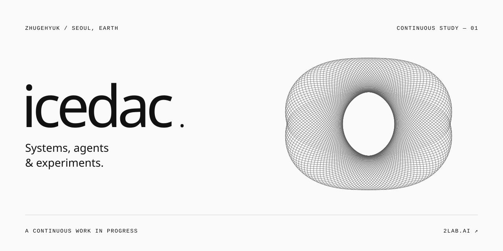

<picture>
  <source media="(max-width: 640px) and (prefers-color-scheme: dark)" srcset="./assets/profile-dark-mobile.svg">
  <source media="(max-width: 640px)" srcset="./assets/profile-light-mobile.svg">
  <source media="(prefers-color-scheme: dark)" srcset="./assets/profile-dark.svg">
  
</picture>

<a href="./STILL.md">Still version</a>

Building at [2lab.ai](https://2lab.ai). Working with AI, thinking in systems, making room for experiments.

 

SELECTED WORK

**[llmux](https://github.com/2lab-ai/llmux)** · A local proxy for Claude, GPT and Grok.  
**[np_alloc](https://github.com/icedac/np_alloc)** · Lock-free memory allocation in C++.  
**[experiments](https://github.com/icedac/experiments)** · WebGL, particles and computational art.

 

[2lab.ai](https://2lab.ai) &nbsp; / &nbsp; [Research](https://github.com/labforadvancedstudy/paper) &nbsp; / &nbsp; [Threads](https://www.threads.com/@zhugehyuk)

Still curious.
