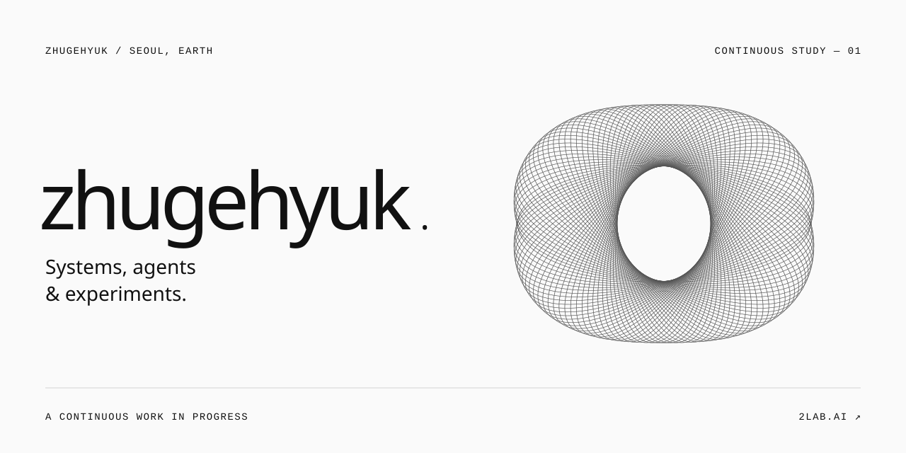

<picture>
  <source media="(max-width: 640px) and (prefers-color-scheme: dark)" srcset="./assets/profile-dark-mobile-still.svg">
  <source media="(max-width: 640px)" srcset="./assets/profile-light-mobile-still.svg">
  <source media="(prefers-color-scheme: dark)" srcset="./assets/profile-dark-still.svg">
  
</picture>

Building at [2lab.ai](https://2lab.ai). Working with AI, thinking in systems, making room for experiments.

**[llmux](https://github.com/2lab-ai/llmux)** · A local proxy for Claude, GPT and Grok.  
**[soma-work](https://github.com/2lab-ai/soma-work)** · AI coding workflows, from a Slack conversation.  
**[ultima6](https://github.com/2lab-ai/ultima6)** · A Rust port of Ultima VI for the Amiga.

[2lab.ai](https://2lab.ai) &nbsp; / &nbsp; [Research](https://github.com/labforadvancedstudy/paper) &nbsp; / &nbsp; [Threads](https://www.threads.com/@zhugehyuk)

Still curious. · [Animated version](./README.md)
